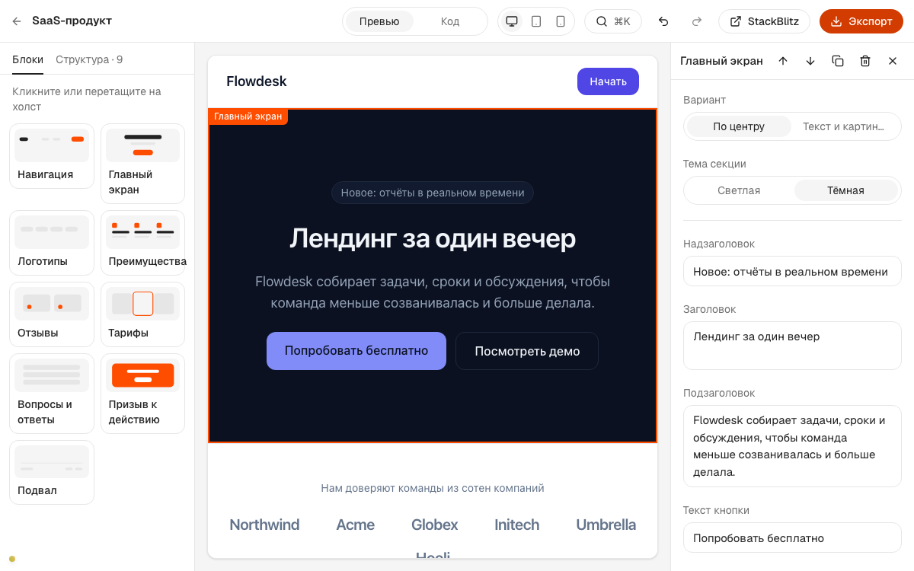
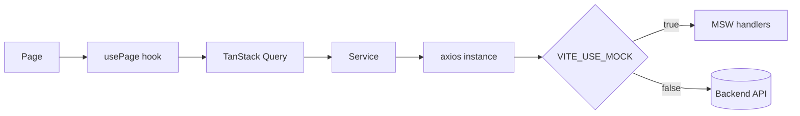

<div align="center">


# Sectio

A Vite React app with a typed API layer, mocks and ready-made CI.

[Русский](README.md) · **English**

[Changelog](CHANGELOG.md) · [Releases](../../releases) · [Report a bug](../../issues)




</div>

## How it works

Pages are lazy-loaded, data is fetched through TanStack Query and services built on a single axios instance. In development MSW intercepts requests, so no backend is needed.



## Stack

[](https://skillicons.dev)

TanStack Query · zustand · react-hook-form · zod · react-router · axios · MSW · Vitest · Playwright

## Quick start

```bash
git clone https://github.com/timurrc/Sectio.git && cd Sectio
bun install && cp .env.example .env
bun dev
```

Opens at `http://localhost:5173`.

## Project structure

```
src/
├── api/          # axios instance
├── blocks/       # block registry: schema, preview and codegen in one module
├── editor/       # editor logic: storage, factories, preview protocol
├── services/     # API requests
├── hooks/        # shared hooks
├── schemas/      # zod form schemas
├── store/        # zustand
├── mocks/        # MSW
├── pages/        # pages and their hooks
├── components/   # ui · modules · layouts
├── constants/    # env, routes, queryKeys
└── utils/        # pure functions
```

## Author

**Timur Abutalipov** — [GitHub](https://github.com/timurrc)
