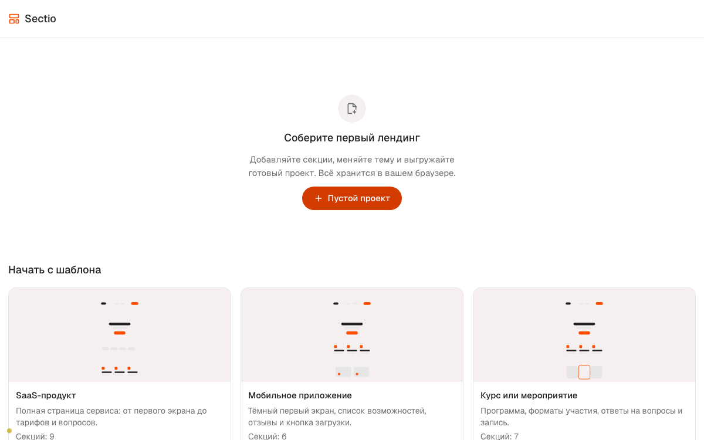
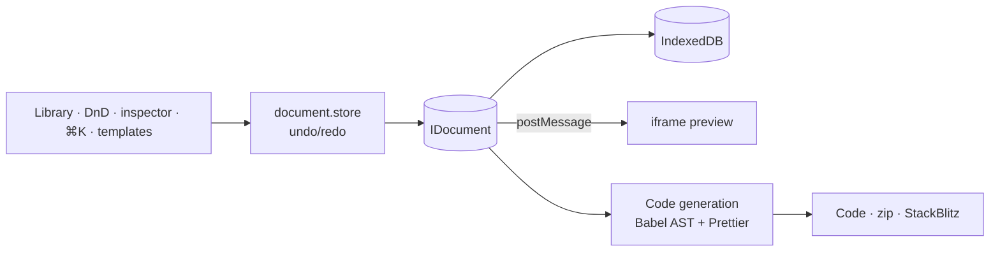

<div align="center">


# Sectio

A visual landing page builder: assemble a page from sections and export a ready Vite + React + Tailwind project.

[Русский](README.md) · **English**

[Report a bug](../../issues)




</div>

## How it works

A page is a JSON document: a list of sections with their data plus a theme. The block library, drag and drop, the inspector, the ⌘K palette, templates and undo only change that document. The iframe preview, the Code tab and the zip or StackBlitz export only read it, so the code always matches the canvas. Everything is stored in the browser's IndexedDB; there is no backend.




## Stack

[](https://skillicons.dev)

zustand + immer + zundo · dnd-kit · zod · Babel · Prettier · Monaco · JSZip · StackBlitz SDK · fuse.js · culori · idb-keyval · Vitest · Playwright · axe

## Quick start

```bash
git clone https://github.com/timurrc/Sectio.git && cd Sectio
bun install && cp .env.example .env
bun dev
```

Opens at `http://localhost:5173`. Checks: `bun run check` (lint, format, unit tests, build) and `bun run e2e`.

## Project structure

```
src/
├── blocks/       # block registry: component, zod schema, codegen — one folder per block
├── editor/       # editor logic: storage, preview protocol, DnD, commands, templates
├── codegen/      # builds the exported Vite project
├── preview/      # standalone preview page for the iframe
├── store/        # zustand: document with history, editor state, projects
├── pages/        # projects list and editor, logic in useXxxPage
├── components/   # ui · modules · layouts
├── constants/    # templates, default theme, export dependency versions
├── hooks/        # shared hooks
├── types/        # document model
└── utils/        # pure functions
e2e/              # Playwright scenarios and demo.gif recording (bun run demo)
```

## Author

**Timur Abutalipov** — [GitHub](https://github.com/timurrc)
