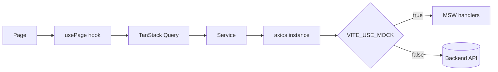

<div align="center">


# Sectio

React-приложение на Vite с типизированным API-слоем, моками и готовым CI.

**Русский** · [English](README.en.md)

[Changelog](CHANGELOG.md) · [Releases](../../releases) · [Сообщить о баге](../../issues)


</div>

## Как это работает

Страницы загружаются лениво, данные запрашиваются через TanStack Query и сервисы поверх одного axios-инстанса. В режиме разработки запросы перехватывает MSW, поэтому бэкенд не нужен.



## Стек

[](https://skillicons.dev)

TanStack Query · zustand · react-hook-form · zod · react-router · axios · MSW · Vitest · Playwright

## Быстрый старт

```bash
git clone https://github.com/timurrc/Sectio.git && cd Sectio
bun install && cp .env.example .env
bun dev
```

Откроется на `http://localhost:5173`.

## Структура проекта

```
src/
├── api/          # axios instance
├── services/     # запросы к API
├── hooks/        # общие хуки
├── schemas/      # zod-схемы форм
├── store/        # zustand
├── mocks/        # MSW
├── pages/        # страницы и их хуки
├── components/   # ui · modules · layouts
├── constants/    # env, routes, queryKeys
└── utils/        # чистые функции
```

## Автор

**Timur Abutalipov** — [GitHub](https://github.com/timurrc)
