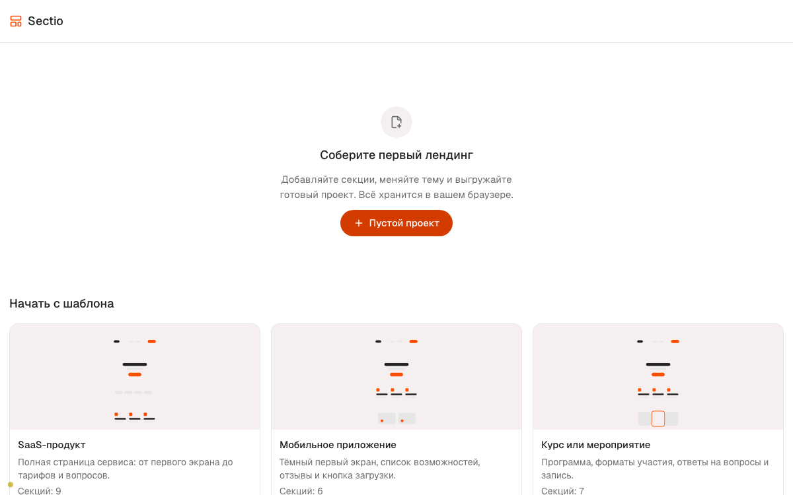
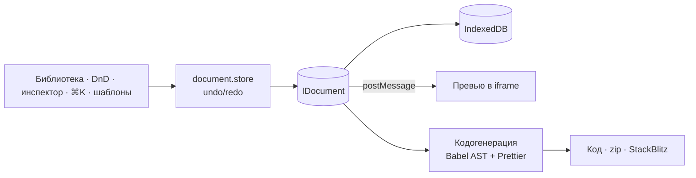
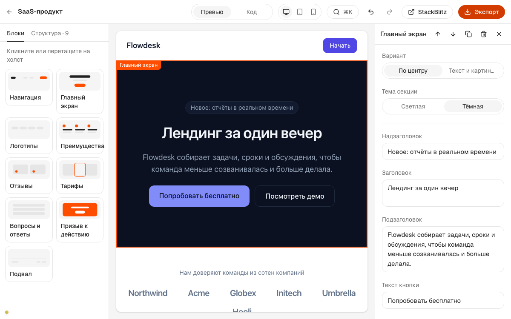

<div align="center">


# Sectio

Визуальный конструктор лендингов: собираете страницу из секций и выгружаете готовый проект на Vite + React + Tailwind.

**Русский** · [English](README.en.md)

[Сообщить о баге](../../issues)




</div>

## Как это работает

Страница — это JSON-документ: список секций с данными и тема. Библиотека блоков, перетаскивание, инспектор, палитра ⌘K, шаблоны и undo меняют только его. Превью в iframe, вкладка «Код» и экспорт в zip или StackBlitz только читают документ, поэтому код всегда совпадает с тем, что видно на холсте. Всё хранится в IndexedDB браузера, бэкенда нет.





## Стек

[](https://skillicons.dev)

zustand + immer + zundo · dnd-kit · zod · Babel · Prettier · Monaco · JSZip · StackBlitz SDK · fuse.js · culori · idb-keyval · Vitest · Playwright · axe

## Быстрый старт

```bash
git clone https://github.com/timurrc/Sectio.git && cd Sectio
bun install && cp .env.example .env
bun dev
```

Откроется на `http://localhost:5173`. Проверки: `bun run check` (lint, формат, unit, сборка) и `bun run e2e`.

## Структура проекта

```
src/
├── blocks/       # реестр блоков: компонент, zod-схема, кодогенерация — по папке на блок
├── core/         # логика редактора: хранение, протокол превью, DnD, команды, шаблоны
├── codegen/      # сборка экспортируемого Vite-проекта
├── preview/      # отдельная страница превью для iframe
├── store/        # zustand: документ с историей, состояние редактора, проекты
├── pages/        # список проектов и редактор, логика в useXxxPage
├── components/   # ui · modules · layouts
├── constants/    # шаблоны, тема по умолчанию, версии зависимостей экспорта
├── hooks/        # общие хуки
├── types/        # модель документа
└── utils/        # чистые функции
e2e/              # сценарии Playwright и запись demo.gif (bun run demo)
```

## Автор

**Timur Abutalipov** — [GitHub](https://github.com/timurrc)
